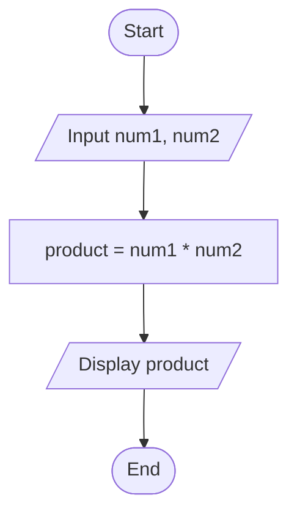
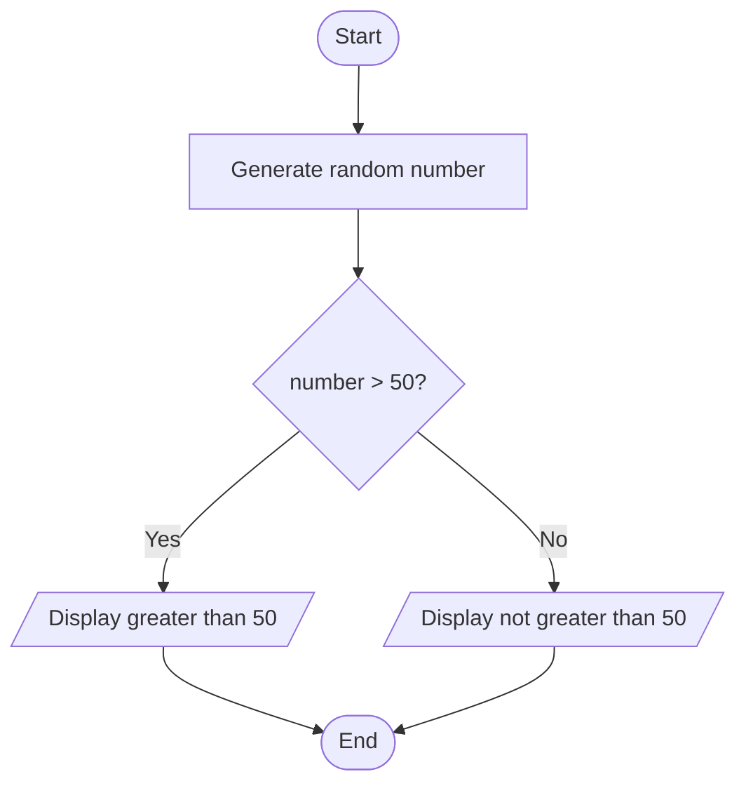
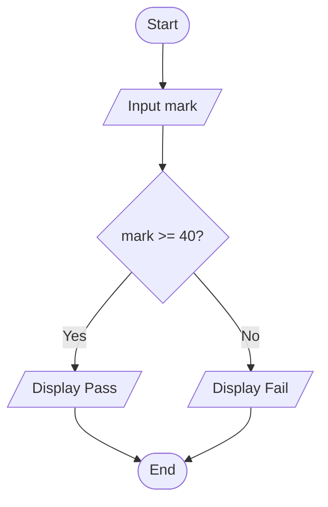
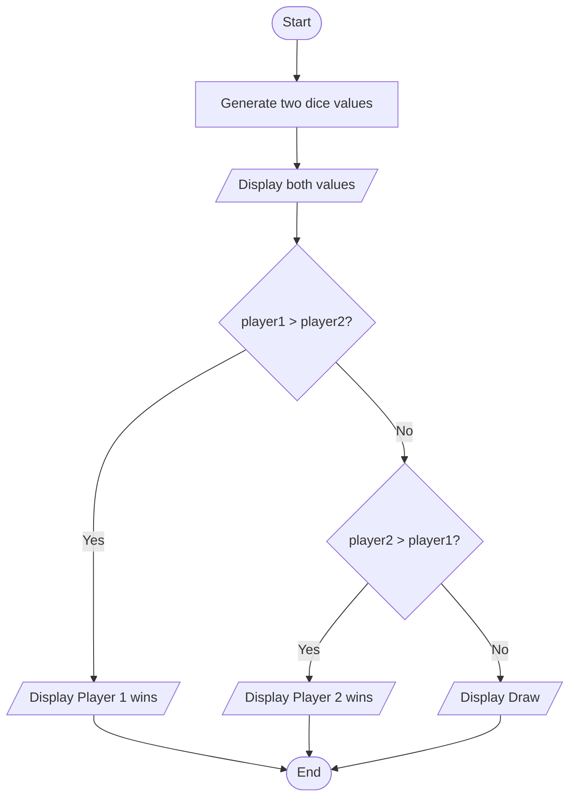
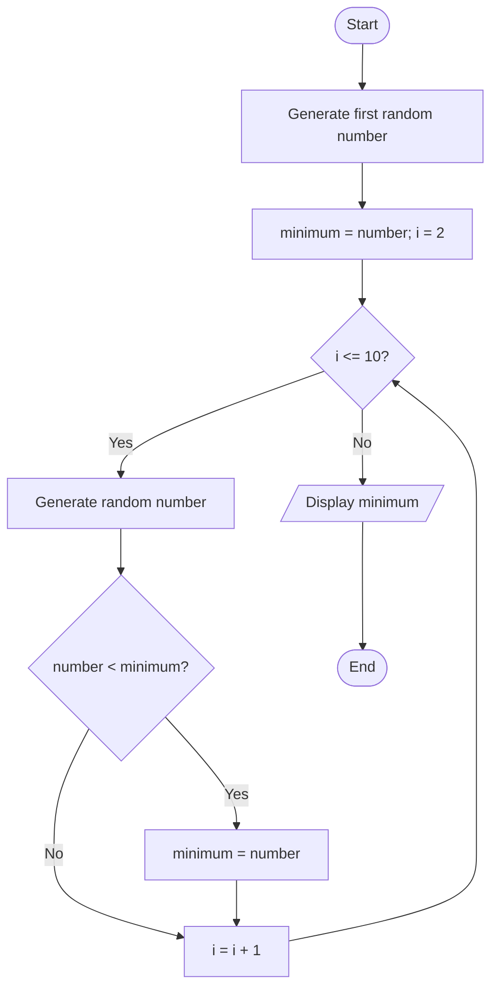
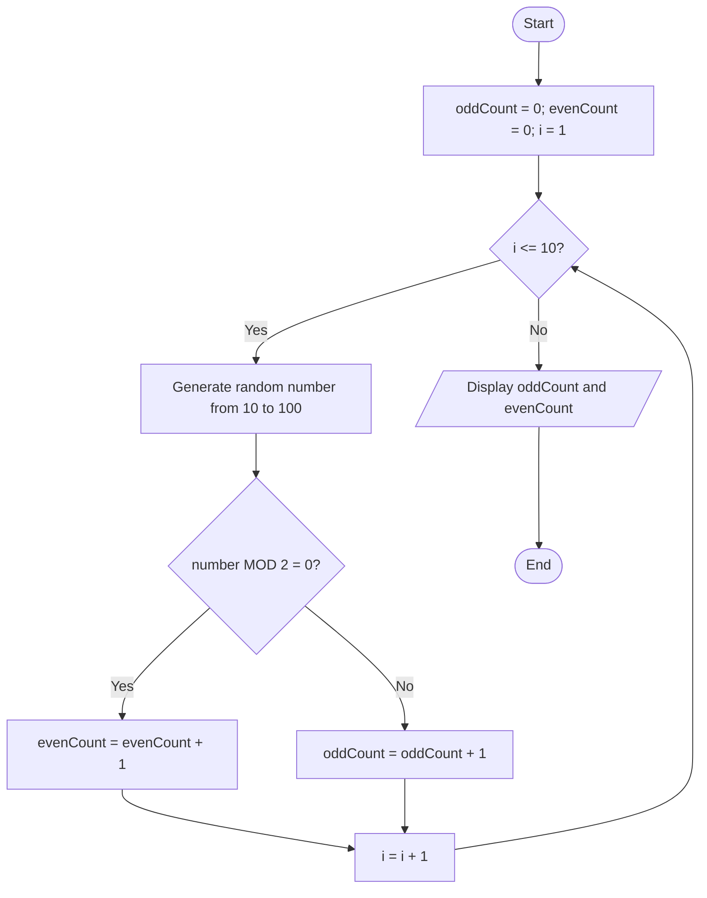
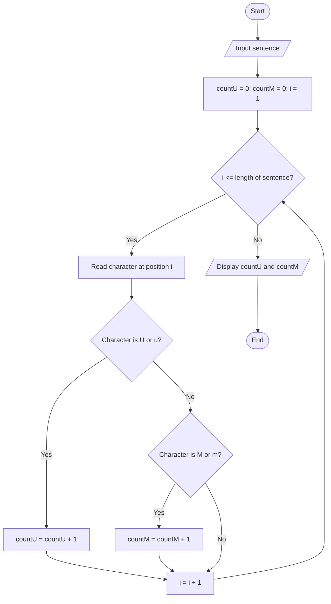
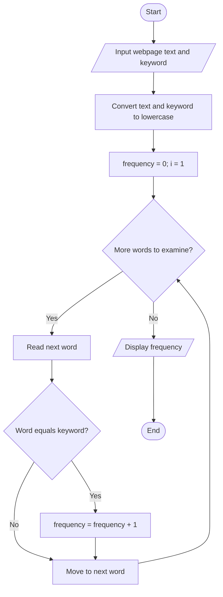
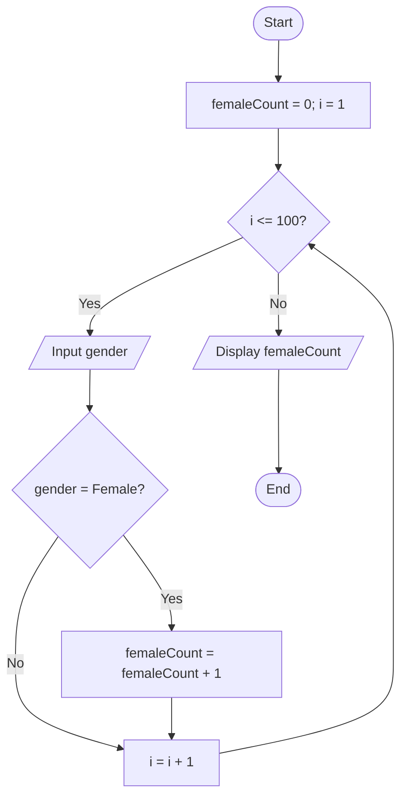
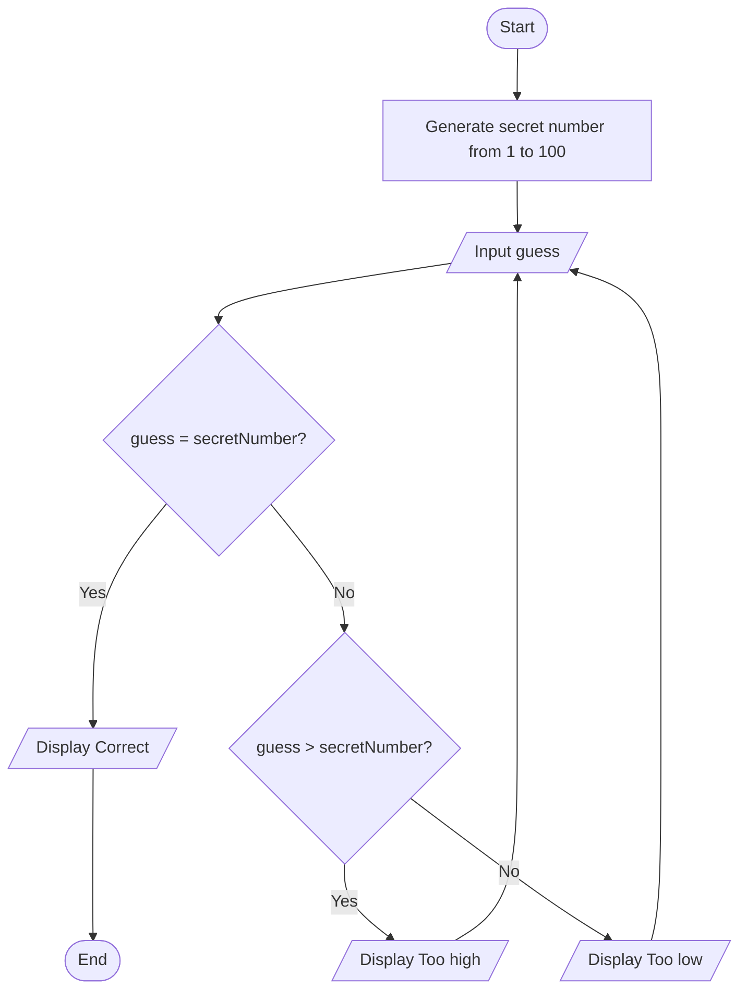

# WIX1002 Fundamentals of Programming
# Tutorial 01 — Problem Solving in Programming

# Part I

## Question 1: Multiplication of Two Numbers

### IPO Model

| Input | Process | Output |
|---|---|---|
| Two numbers, `num1` and `num2` | Calculate `product = num1 * num2` | Product of the two numbers |

### Pseudocode

```text
BEGIN
    INPUT num1
    INPUT num2
    product = num1 * num2
    OUTPUT product
END
```

### Flowchart



## Question 2: Determine Whether a Random Number Is Greater Than 50

### IPO Model

| Input | Process | Output |
|---|---|---|
| A random number generated by the computer | Generate a random number and compare it with 50 | Display whether the number is greater than 50 |

### Pseudocode

```text
BEGIN
    number = RANDOM(1, 100)

    IF number > 50 THEN
        OUTPUT "The number is greater than 50"
    ELSE
        OUTPUT "The number is not greater than 50"
    ENDIF
END
```

### Flowchart



## Question 3: Pass or Fail Grade

### IPO Model

| Input | Process | Output |
|---|---|---|
| Student's mark | Compare the mark with 40 | Display Pass or Fail |

### Pseudocode

```text
BEGIN
    INPUT mark

    IF mark >= 40 THEN
        OUTPUT "Pass"
    ELSE
        OUTPUT "Fail"
    ENDIF
END
```

### Flowchart



## Question 4: Two Players' Dice Game

**Assumption:** Each player rolls one six-sided die. The player with the higher number wins. If both numbers are equal, the game is a draw.

### IPO Model

| Input | Process | Output |
|---|---|---|
| Two random dice values | Generate one value for each player and compare them | Both dice values and the game result |

### Pseudocode

```text
BEGIN
    player1 = RANDOM(1, 6)
    player2 = RANDOM(1, 6)

    OUTPUT "Player 1 rolled: ", player1
    OUTPUT "Player 2 rolled: ", player2

    IF player1 > player2 THEN
        OUTPUT "Player 1 wins"
    ELSE IF player2 > player1 THEN
        OUTPUT "Player 2 wins"
    ELSE
        OUTPUT "Draw"
    ENDIF
END
```

### Flowchart



## Question 5: Perimeter of a Rectangle

### IPO Model

| Input | Process | Output |
|---|---|---|
| Length and width of a rectangle | Calculate `perimeter = 2 * (length + width)` | Perimeter of the rectangle |

### Pseudocode

```text
BEGIN
    INPUT length
    INPUT width

    perimeter = 2 * (length + width)

    OUTPUT perimeter
END
```

### Flowchart

```mermaid
flowchart TD
    A([Start]) --> B[/Input length and width/]
    B --> C[perimeter = 2 * (length + width)]
    C --> D[/Display perimeter/]
    D --> E([End])
```

## Question 6: Minimum Number from 10 Random Numbers

### IPO Model

| Input | Process | Output |
|---|---|---|
| Ten random numbers generated by the computer | Initialize the minimum with the first number; compare the remaining nine numbers and update the minimum when necessary | The minimum number |

### Pseudocode

```text
BEGIN
    number = RANDOM(1, 100)
    minimum = number
    OUTPUT number

    FOR i = 2 TO 10
        number = RANDOM(1, 100)
        OUTPUT number

        IF number < minimum THEN
            minimum = number
        ENDIF
    ENDFOR

    OUTPUT "Minimum number: ", minimum
END
```

### Flowchart



## Question 7: Count Odd and Even Numbers

### IPO Model

| Input | Process | Output |
|---|---|---|
| Ten random integers between 10 and 100, inclusive | Check each number using `number MOD 2`; increment the appropriate counter | Total number of odd and even numbers |

### Pseudocode

```text
BEGIN
    oddCount = 0
    evenCount = 0

    FOR i = 1 TO 10
        number = RANDOM(10, 100)
        OUTPUT number

        IF number MOD 2 = 0 THEN
            evenCount = evenCount + 1
        ELSE
            oddCount = oddCount + 1
        ENDIF
    ENDFOR

    OUTPUT "Number of even numbers: ", evenCount
    OUTPUT "Number of odd numbers: ", oddCount
END
```

### Flowchart



# Part II

## Question 8: Count the Letters U and M in a Sentence

**Assumption:** Count both uppercase and lowercase letters, so `U`, `u`, `M`, and `m` are counted.

### IPO Model

| Input | Process | Output |
|---|---|---|
| A sentence entered by the user | Examine each character and count occurrences of U and M without considering case | Number of U letters and number of M letters |

### Pseudocode

```text
BEGIN
    INPUT sentence

    countU = 0
    countM = 0

    FOR each character IN sentence
        IF character = 'U' OR character = 'u' THEN
            countU = countU + 1
        ELSE IF character = 'M' OR character = 'm' THEN
            countM = countM + 1
        ENDIF
    ENDFOR

    OUTPUT "Number of U letters: ", countU
    OUTPUT "Number of M letters: ", countM
END
```

### Flowchart



## Question 9: Display the Frequency of a Keyword from a Web Page

**Assumption:** The web page's text has already been obtained, and the keyword is entered by the user. Count occurrences as whole words, ignoring uppercase and lowercase differences. Retrieving the web page itself is outside this algorithm.

### IPO Model

| Input | Process | Output |
|---|---|---|
| Web page text and a keyword | Search the text for whole-word matches and count the occurrences | Frequency of the keyword |

### Pseudocode

```text
BEGIN
    INPUT webpageText
    INPUT keyword

    frequency = 0

    Convert webpageText to lowercase
    Convert keyword to lowercase

    FOR each word IN webpageText
        IF word = keyword THEN
            frequency = frequency + 1
        ENDIF
    ENDFOR

    OUTPUT "Keyword frequency: ", frequency
END
```

### Flowchart



## Question 10: Count the Number of Female Students

**Assumption:** The list contains 100 students, and each student's gender is recorded as either Female or Male.

### IPO Model

| Input | Process | Output |
|---|---|---|
| Gender information for 100 students | Examine each student's gender and increment the female counter when the gender is Female | Total number of female students |

### Pseudocode

```text
BEGIN
    femaleCount = 0

    FOR i = 1 TO 100
        INPUT gender

        IF gender = "Female" THEN
            femaleCount = femaleCount + 1
        ENDIF
    ENDFOR

    OUTPUT "Number of female students: ", femaleCount
END
```

### Flowchart



## Question 11: Display Five Random Numbers in Descending Order

### IPO Model

| Input | Process | Output |
|---|---|---|
| Five random numbers generated by the computer | Store the numbers and sort them from largest to smallest | Five random numbers in descending order |

### Pseudocode

```text
BEGIN
    DECLARE numbers[5]

    FOR i = 1 TO 5
        numbers[i] = RANDOM(1, 100)
    ENDFOR

    FOR i = 1 TO 4
        FOR j = 1 TO 5 - i
            IF numbers[j] < numbers[j + 1] THEN
                temp = numbers[j]
                numbers[j] = numbers[j + 1]
                numbers[j + 1] = temp
            ENDIF
        ENDFOR
    ENDFOR

    OUTPUT "Numbers in descending order: "

    FOR i = 1 TO 5
        OUTPUT numbers[i]
    ENDFOR
END
```

### Flowchart

```mermaid
flowchart TD
    A([Start]) --> B[Generate and store 5 random numbers]
    B --> C[Set i = 1]
    C --> D{i <= 4?}
    D -- Yes --> E[Set j = 1]
    E --> F{j <= 5 - i?}
    F -- Yes --> G{numbers[j] < numbers[j+1]?}
    G -- Yes --> H[Swap numbers[j] and numbers[j+1]]
    G -- No --> I[j = j + 1]
    H --> I
    I --> F
    F -- No --> J[i = i + 1]
    J --> D
    D -- No --> K[/Display sorted numbers/]
    K --> L([End])
```

## Question 12: Guess a Random Number Generated by the Computer

**Assumption:** The computer generates a random integer from 1 to 100. The user keeps guessing until the correct number is entered. The program provides hints.

### IPO Model

| Input | Process | Output |
|---|---|---|
| Number guessed by the user | Compare the guess with the randomly generated number and repeat until they match | Hint indicating too high, too low, or correct |

### Pseudocode

```text
BEGIN
    secretNumber = RANDOM(1, 100)

    REPEAT
        INPUT guess

        IF guess > secretNumber THEN
            OUTPUT "Too high. Try again."
        ELSE IF guess < secretNumber THEN
            OUTPUT "Too low. Try again."
        ELSE
            OUTPUT "Correct! You guessed the number."
        ENDIF

    UNTIL guess = secretNumber
END
```

### Flowchart



---

# End of Tutorial 01